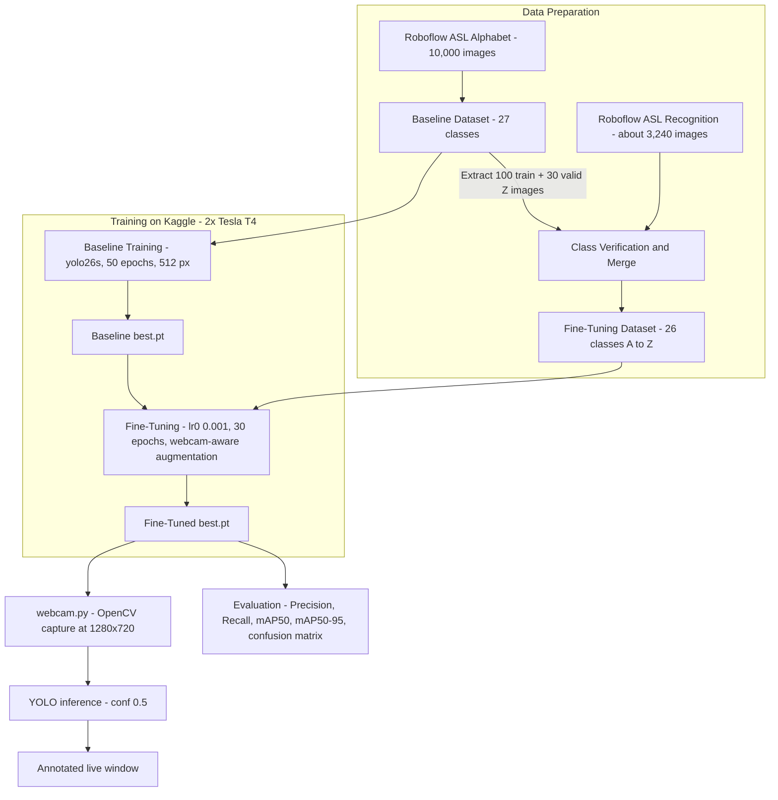

<div align="center">

# YOLO ASL — Real-Time American Sign Language Alphabet Recognition

**YOLO26 object detection model trained to locate a hand and classify its ASL letter, shipped with a preprocessed YOLO-format dataset, trained weights, the full training notebook and a live webcam demo.**

<p align="center">
  <strong>Demo Video:</strong> <a href="https://github.com/trxshi747/YOLO-ASL-Preprocessed-DataSet/raw/main/demo/asl-webcam-demo.mp4">demo/asl-webcam-demo.mp4</a>
</p>

[](https://github.com/trxshi747/YOLO-ASL-Preprocessed-DataSet)
[](https://docs.ultralytics.com/)
[](https://www.python.org/)
[](https://pytorch.org/)
[](https://opencv.org/)
[](https://roboflow.com/)
[](https://www.kaggle.com/)

<br />

<p align="center">
  <a href="#demo">Demo</a> •
  <a href="#overview">Overview</a> •
  <a href="#features">Features</a> •
  <a href="#pipeline-architecture">Pipeline</a> •
  <a href="#tech-stack">Tech Stack</a> •
  <a href="#quick-start">Quick Start</a> •
  <a href="#dataset">Dataset</a> •
  <a href="#training-and-results">Results</a> •
  <a href="#repository-structure">Structure</a> •
  <a href="#frequently-asked-questions-faq">FAQ</a>
</p>

</div>

---

## Demo

https://github.com/user-attachments/assets/3fbbdf81-c246-4806-82ed-11375b6eb0c0

The recording shows the model running live on a webcam stream: each frame is passed to the detector, the hand is boxed and the predicted ASL letter is drawn on top of the image in real time.

---

## Overview

**YOLO ASL** is an Applied AI project that recognizes the static letters of the American Sign Language (ASL) alphabet from images and from a live camera. Instead of classifying a cropped hand, the system uses **object detection**: a single YOLO26 network predicts both the **location** of the hand (bounding box) and the **ASL letter** (class) in one forward pass, which keeps latency low enough for real-time use.

The work follows a two-stage strategy documented in the notebook:

1. **Baseline training** of `yolo26s` on a 10,000-image studio-quality Roboflow dataset (mAP@50 of 0.969).
2. **Fine-tuning** on a more diverse, webcam-oriented dataset with stronger augmentation, plus injection of the missing letter Z, to bridge the gap between studio images and real webcam footage (mAP@50-95 from 0.651 to 0.868).

This repository contains the **preprocessed dataset in YOLO format**, the **trained weights**, the **training notebook** and the **webcam inference scripts**.

---

## Features

- **Single-Pass Detection and Classification**:
  - YOLO26s detector (about 9.5 million parameters, 20.6 GFLOPs) predicts the hand box and the letter simultaneously.
  - About 9.7 ms of inference per image on a Tesla T4 GPU, which supports real-time use.

- **Preprocessed YOLO-Format Dataset**:
  - 66,673 images with 66,673 matching label files, ready to train with Ultralytics.
  - 29 classes: letters A to Z plus the utility signs `del`, `nothing` and `space`.
  - One label file per image with the normalized `class x_center y_center width height` format.

- **Two-Stage Training Workflow**:
  - Baseline on studio-quality images, then low-learning-rate fine-tuning on varied, webcam-like images.
  - Webcam-aware augmentation: brightness and saturation shifts, small rotations, translation, scaling and random erasing.
  - Targeted injection of 100 train and 30 validation images of the letter Z, because the fine-tuning dataset has no Z.

- **Live Webcam Demo**:
  - `webcam.py` opens the camera at 1280x720, runs the detector on every frame with a 0.5 confidence threshold and displays annotated frames in a resizable window.
  - `tets.py` scans camera ports to find the right device index.

- **Reproducible Notebook**:
  - Complete experiment, from environment setup to evaluation, per-class comparison and a text-to-ASL translation demo, in [`notebooks/yolo.ipynb`](notebooks/yolo.ipynb).

---

## Pipeline Architecture



---

## Tech Stack

| Domain | Technologies & Libraries |
|---|---|
| **Model** | Ultralytics YOLO26 (`yolo26s`), transfer learning and fine-tuning |
| **Deep Learning** | PyTorch (CUDA) |
| **Computer Vision** | OpenCV (capture, display), Matplotlib and Seaborn (analysis plots) |
| **Datasets** | Roboflow Universe (`lsmdetection/asl-alphabet-fb7de`, `yolo-ns0c3/asl-alphabet-recognition-wamqa`), YOLO annotation format |
| **Training Hardware** | Kaggle notebook with dual Tesla T4 GPUs (about 1.16 hours for the baseline) |
| **Language** | Python 3.10+ |

---

## Quick Start

### 1. Prerequisites
- **Python**: `3.10` or higher ([Download](https://www.python.org/downloads/))
- **A webcam**: built-in or USB
- **GPU (optional)**: an NVIDIA GPU with CUDA speeds up inference, the model also runs on CPU

### 2. Clone the Repository

The `weights/` folder and the dataset are large. To fetch only the code, the scripts and the demo, use a partial clone:

```bash
git clone --filter=blob:none --sparse https://github.com/trxshi747/YOLO-ASL-Preprocessed-DataSet.git
cd YOLO-ASL-Preprocessed-DataSet
git sparse-checkout set --no-cone /README.md /webcam.py /tets.py /notebooks /demo /weights
```

To get everything, including the full dataset:

```bash
git clone https://github.com/trxshi747/YOLO-ASL-Preprocessed-DataSet.git
cd YOLO-ASL-Preprocessed-DataSet
```

### 3. Install Dependencies

```bash
pip install -U ultralytics opencv-python
```

### 4. Find Your Camera Index

```bash
python tets.py
```

The script tests ports 0 to 4 and prints the ones that open. If your camera is not on port `0`, change `cv2.VideoCapture(0)` in `webcam.py` accordingly.

### 5. Run the Live Demo

```bash
python webcam.py
```

Show an ASL letter to the camera. The detected hand and its letter are displayed live. Press `q` to quit.

### 6. Run Inference on an Image

```python
from ultralytics import YOLO

model = YOLO("weights/best.pt")
results = model("images/train/A1.jpg", conf=0.5)
results[0].show()
```

### 7. Train or Fine-Tune on Your Own Data

```python
from ultralytics import YOLO

model = YOLO("weights/best.pt")        # start from the trained weights
model.train(
    data="data.yaml",                  # your dataset configuration
    epochs=30,
    imgsz=512,
    batch=16,
    lr0=0.001,
    hsv_s=0.8, hsv_v=0.5, degrees=10, translate=0.1, scale=0.4, erasing=0.4,
)
```

---

## Dataset

The repository ships the **Preprocessed Dataset for YOLO**, organized in the standard Ultralytics layout.

| Item | Value |
|---|---|
| Images | 66,673 files in `images/train/` |
| Labels | 66,673 files in `labels/train/` (one per image) |
| Annotation format | `class x_center y_center width height`, all values normalized between 0 and 1 |
| Classes | 29: `A` to `Z` (ids 0 to 25), `del`, `nothing`, `space` (ids up to 28) |
| Naming convention | `<class><number>.jpg` and `<class><number>.txt`, for example `A1.jpg` and `A1.txt` |
| Per-class volume | From about 1,300 images for the smallest letter class to 3,000 for `nothing` |

Example label file (`labels/train/A1.txt`):

```text
0 0.4887 0.3816 0.4260 0.5034
```

### Datasets Used in the Notebook

| Stage | Source | Images | Classes | License |
|---|---|---|---|---|
| Baseline | Roboflow `lsmdetection/asl-alphabet-fb7de` (version 2) | 10,000 (6,000 train, 2,000 validation, 2,000 test) | 27 (A to Z and `nothing`) | CC BY 4.0 |
| Fine-tuning | Roboflow `yolo-ns0c3/asl-alphabet-recognition-wamqa` (version 2) | about 3,240, plus 130 injected Z images | 26 (A to Z) | CC BY 4.0 |

The fine-tuning dataset does not contain the letter Z, a dynamic sign that is hard to capture in a still photo. To avoid catastrophic forgetting of this class, 100 training and 30 validation Z images were extracted from the baseline dataset and merged in, and the `data.yaml` file was rewritten with exactly 26 classes.

---

## Training and Results

### Training Configuration

| Parameter | Baseline | Fine-Tuning |
|---|---|---|
| Starting weights | `yolo26s.pt` (COCO pretrained) | Baseline `best.pt` |
| Image size | 512 | 512 |
| Epochs | 50 | 30 |
| Batch size | 16 | 16 |
| Learning rate (`lr0`) | 0.01 | 0.001 |
| Augmentation | Ultralytics defaults | `hsv_h` 0.02, `hsv_s` 0.8, `hsv_v` 0.5, `degrees` 10, `translate` 0.1, `scale` 0.4, `fliplr` 0, `mosaic` 1.0, `erasing` 0.4 |
| Hardware | 2x Tesla T4 (Kaggle) | 2x Tesla T4 (Kaggle) |

### Metrics

| Metric | Baseline | Fine-Tuned | Change |
|---|---|---|---|
| Precision | 0.965 | 0.971 | +0.006 |
| Recall | 0.960 | 0.992 | +0.032 |
| mAP@50 | 0.969 | 0.995 | +0.026 |
| mAP@50-95 | 0.651 | 0.868 | +0.217 |

### Weak Classes Before and After Fine-Tuning (mAP@50)

| Class | Baseline | Fine-Tuned |
|---|---|---|
| A | 0.942 | 0.995 |
| H | 0.883 | 0.995 |
| M | 0.902 | 0.995 |
| S | 0.954 | 0.995 |

### Key Observations
- The baseline converged around epochs 25 to 40, with no severe overfitting.
- The largest gain is in **mAP@50-95** (+0.217), meaning much tighter bounding boxes under strict overlap thresholds, which matters most for live use.
- Fine-tuning with a 10x lower learning rate preserved previous knowledge while adapting the model to webcam lighting and backgrounds.
- The injected letter Z has the lowest mAP@50-95 (0.586), since its images come from the studio dataset.
- Visually close signs (M/N, U/V, S/E) remain the main source of confusion for a 2D camera.

The fine-tuned metrics are measured on the validation split of the fine-tuning dataset (297 images), the baseline metrics on the validation split of the baseline dataset (2,000 images). They are not computed on the same images and should be read as indicative.

---

## Repository Structure

```text
YOLO-ASL-Preprocessed-DataSet/
├── README.md                  # Project documentation
├── webcam.py                  # Real-time webcam inference with OpenCV and YOLO
├── tets.py                    # Utility that lists the available camera ports
│
├── demo/
│   └── asl-webcam-demo.mp4    # Screen recording of the live demo
│
├── notebooks/
│   └── yolo.ipynb             # Full training, fine-tuning and evaluation notebook
│
├── weights/
│   ├── best.pt                # Best checkpoint (highest validation fitness)
│   └── last.pt                # Last checkpoint of the training run
│
├── images/
│   └── train/                 # 66,673 preprocessed images
│
└── labels/
    └── train/                 # 66,673 YOLO-format label files
```

---

## Frequently Asked Questions (FAQ)

<details>
<summary><b>1. Why is object detection used instead of plain image classification?</b></summary>
<br>
Detection gives both the letter and the hand position. It works on full frames with a cluttered background, which is what a webcam provides, whereas a classifier needs an already cropped hand.
</details>

<details>
<summary><b>2. The webcam window does not open or shows the wrong camera. What should I do?</b></summary>
<br>
Run <code>python tets.py</code> to list the camera ports that respond, then edit <code>cv2.VideoCapture(0)</code> in <code>webcam.py</code> with the right index. Make sure no other application is using the camera.
</details>

<details>
<summary><b>3. Why are some letters confused with each other?</b></summary>
<br>
Several ASL letters differ only by a slight finger position (for example M and N, U and V, S and E). With a single 2D camera these shapes can look almost identical, so some confusion is expected even with a strong model.
</details>

<details>
<summary><b>4. Why are the letters J and Z harder?</b></summary>
<br>
J and Z are dynamic signs that require a movement. A still image only captures part of the gesture, so these classes are less reliable than static letters. Z was also added to the fine-tuning set from studio images, which explains its lower localization score.
</details>

<details>
<summary><b>5. The repository is heavy. How can I avoid downloading everything?</b></summary>
<br>
Use the partial clone with sparse checkout shown in the Quick Start. It downloads only the scripts, the notebook, the demo and the weights, and skips the 133,000 dataset files until you need them.
</details>

<details>
<summary><b>6. Which Ultralytics version is required?</b></summary>
<br>
The notebook was run with Ultralytics 8.4.33 and PyTorch 2.10. Install the latest release with <code>pip install -U ultralytics</code> so that YOLO26 checkpoints load correctly.
</details>

---

## License

No license has been specified for the code and the weights yet. The Roboflow datasets used for training are published under CC BY 4.0 by their respective authors; please follow their attribution requirements.

<div align="center">
  <sub>Applied AI module project by Abdelalime Lahbib and Yasser Karouti, repository maintained by <a href="https://github.com/trxshi747">trxshi747</a>.</sub>
</div>
